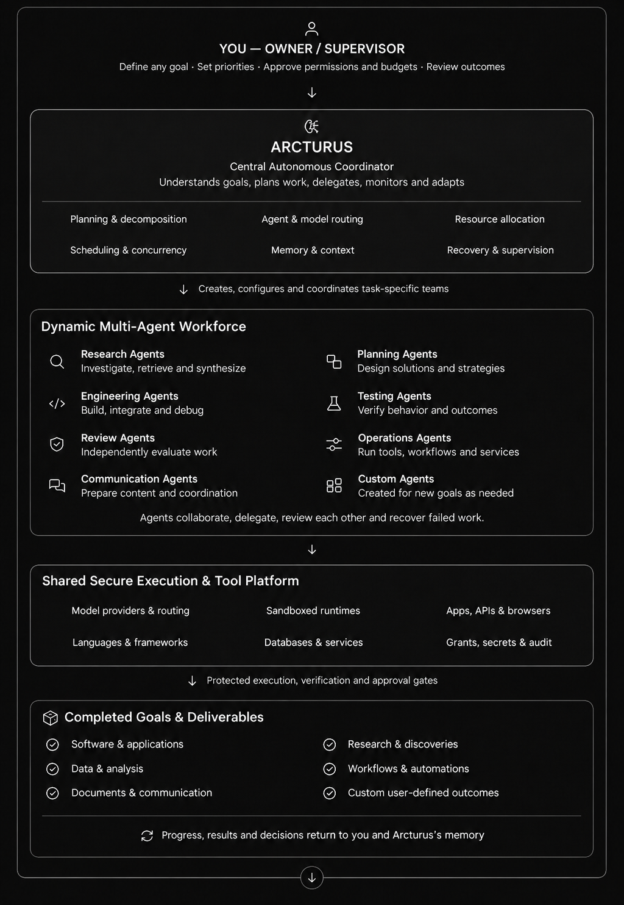

# Arcturus

**Arcturus is a secure, customizable, and extensible multi-agent workstation that coordinates AI agents, models, and
tools to plan, execute, review, and recover complex workflows, turning high-level goals into verified results with
human oversight.**

The goal: give it any goal, such as build an application, a research study, coordinate a complex engineering
project, a data analysis or an ongoing workflow, and it picks the approach, assembles the agents and tools, does the
work and recovers from failures. **Arcturus should adapt to the task, not the task to Arcturus.**

<p align="center">
  
</p>

## What it does today

- **Build.** Turns a written spec into working, tested software. Models write the code, the code runs in a sandbox
  against hidden acceptance tests the builder never sees, an independent model reviews it, and failures get
  targeted repairs.
- **Research.** Produces source-backed research: captures the sources, checks every quote against them, cites each
  finding, and has a second model challenge the conclusions.
- **Evaluate.** Benchmarks AI agents in a sandbox. Every model call goes through a broker, and a verifier replays the
  run and must reproduce the report byte for byte.
- **Pipeline.** Chains all three into a continuous queue that runs unattended: it finds companies, researches each
  one, decides which project would matter to it, writes the spec, builds and reviews the project, and drafts the
  notes and outreach, for several companies in parallel.

## What makes it work

- **Model routing.** Each step goes to the right model across Claude, Codex, DeepSeek and others: subscriptions
  first, APIs when their limits run low, so work never stops.
- **Spending control.** Every paid call runs inside a budget I approve once with Touch ID, and is reserved in a
  ledger before it is sent.
- **Sandboxed execution.** Generated code runs in an isolated account with no network and no access to API keys.
- **Independent review.** Hidden tests decide acceptance, and in the pipeline the final reviewer always comes from a
  provider that wrote none of the code.
- **Resumable.** Every step is checkpointed, so a stopped run picks up where it left off and nothing is paid twice.
- **Human in control.** Arcturus prepares drafts. It never sends, applies, posts or deploys on its own.

## Built with Arcturus

| Project | What it is | Result |
|---|---|---|
| [**Tracebench**](https://github.com/yashgix/tracebench) · [page](https://yashgix.github.io/tracebench/) | A replayable benchmark that evaluates AI SRE agents on production incidents, built by the Arcturus build loop and Claude Code, reviewed by Codex | 12 incidents × 3 models, 220 model calls for $0.22; every fix judged by hidden checks and a traffic replay |
| [**Salus Bridge**](https://github.com/yashgix/salus-bridge) · [page](https://yashgix.github.io/salus-bridge/artifact/) | A trusted execution boundary for AI agents' tool calls (TypeScript), built by a restricted builder agent under Arcturus | 10 of 10 safety invariants held, against 3 of 10 for a deliberately flawed integration, across 10 scenarios × 30 seeded runs |
| [**Paradev CI Recovery**](https://yashgix.github.io/paradev-ci-recovery/) | Automatic recovery of failed CI in an open-source agent platform, led by Claude Code with Codex reviewing every milestone | Failed CI to passing CI in under 3.5 minutes with one human review; proposed upstream on [issue #7522](https://github.com/ParadevAI/Paradev/issues/7522) |

## How it was built

With coding agents, which was also the point: Claude Code as lead developer, Codex as independent reviewer and
ChatGPT for planning reviews. They coordinate through shared plain-file records, so any tool or account can pick up
the work. I set the direction and approve every phase.

## Run the tests

macOS and Python 3.14, plus `pip install ruff==0.17.4`. No test makes a paid call.

```sh
make lint            # ruff check and format check
make test            # portable suites, no setup needed
make test-sandbox    # build, evaluation and approval suites; needs the sandbox account (exec-user/README.md)
```

Shared to show the work; not licensed for reuse.
